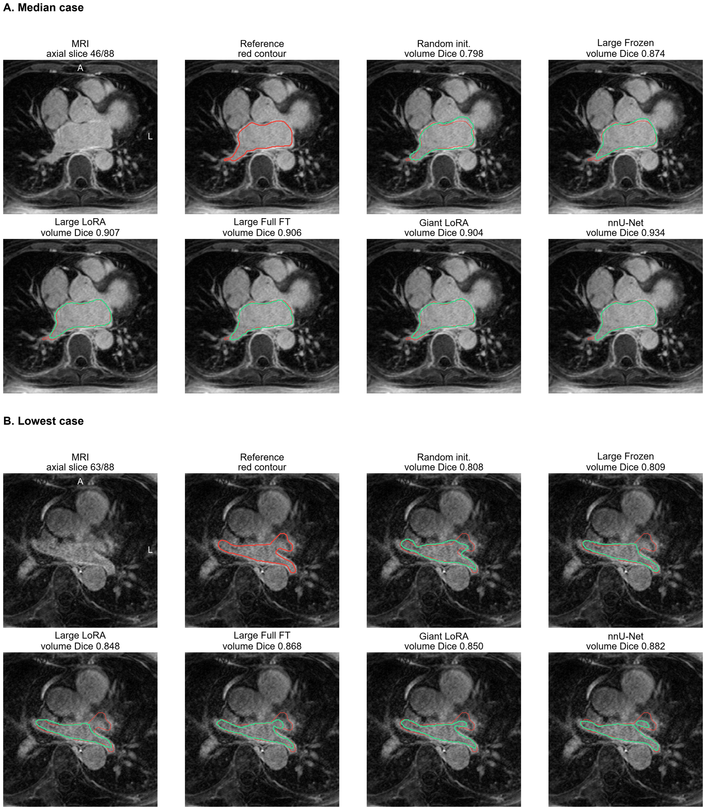

# AdaDINO-LA: A Controlled Study of DINOv2 Adaptation Strategies for Left Atrial Segmentation in LGE-MRI


Code, fixed case lists, per-case results and table-reproduction scripts for the paper.

---

## Table of Contents

- [Overview](#overview)
- [Installation](#installation)
- [Dataset Preparation](#dataset-preparation)
- [Usage](#usage)
  - [Preprocessing](#preprocessing)
  - [Training and Evaluation](#training-and-evaluation)
  - [Additional Analyses](#additional-analyses)
  - [nnU-Net Reference](#nnu-net-reference)
  - [Reproducing the Tables](#reproducing-the-tables)
- [Results](#results)
- [Repository Layout](#repository-layout)
- [Notes on Interpretation](#notes-on-interpretation)
- [Citation](#citation)
- [License](#license)
- [Acknowledgements](#acknowledgements)

---

## Overview

**AdaDINO-LA** is a controlled empirical comparison, not a new network. It asks how a DINOv2
encoder should be adapted for left atrial (LA) cavity segmentation in late gadolinium-enhanced
MRI (LGE-MRI). Frozen extraction, partial fine-tuning, low-rank adaptation (LoRA) and full
fine-tuning of DINOv2 ViT-Large and ViT-Giant share one case-level split (108/15/31 volumes),
preprocessing pipeline, decoder topology, loss implementation and checkpoint rule. Every
configuration is trained with three seeds and evaluated on reconstructed native-resolution 3D
volumes, with a no-pretraining control, recipe-sensitivity analyses, external evaluation and a
task-specific nnU-Net ResEnc-M 3D reference on the same cases.

### Key Findings

| Question | Result (test Dice, mean over three seeds) |
|----------|-------------------------------------------|
| Does DINOv2 pretraining matter? | ViT-Large Full FT 0.907 versus 0.764 from random initialization (+14.3 points, higher in all 31 cases) |
| Which adaptation strategy? (main protocol) | Frozen 0.875, Partial FT 0.885, LoRA 0.899, Full FT 0.907 |
| Under one improved recipe for all strategies | Frozen 0.903, Partial FT 0.908, LoRA 0.912, Full FT 0.912 (LoRA matches Full FT at about 56% of the training memory) |
| Does a larger backbone help? | ViT-Giant adds at most 0.6 points at 2.6 to 3.3 times the training memory |
| Task-specific reference | nnU-Net 0.930 internally; inconclusive on external LGE data; higher on bSSFP data |

---

## Installation

### Requirements

- Python 3.11
- PyTorch 2.11 (the reported runs used PyTorch 2.8 to 2.11 with CUDA 12.6 to 12.8)
- One NVIDIA GPU with at least 10 GB memory for ViT-Large (ViT-Giant LoRA needs about 16 GB)

### Setup Environment

```bash
# 1. Clone the repository
git clone https://github.com/qkhanhbe/AdaDINO-LA.git
cd AdaDINO-LA

# 2. Create a conda environment
conda create -n adadino-la python=3.11 -y
conda activate adadino-la

# 3. Install PyTorch with CUDA 12.8
pip install torch==2.11.0 torchvision --index-url https://download.pytorch.org/whl/cu128

# 4. Install dependencies
pip install -r requirements.txt
```

DINOv2 code and pretrained weights (`dinov2_vitl14`, `dinov2_vitg14`) are fetched through
`torch.hub` (`facebookresearch/dinov2`) on first use.

---

## Dataset Preparation

### Datasets

| Dataset | Role | Volumes | Source |
|---------|------|---------|--------|
| **Utah 2018 LA Segmentation Challenge** | Training, validation, internal test | 154 LGE-MRI | Xiong et al., *Med. Image Anal.* 67 (2021) 101832; obtain from the challenge organisers |
| **CDEMRIS** | External test (inference only) | 40 LGE-MRI from 20 patients | Karim et al., *J. Cardiovasc. Magn. Reson.* 15 (2013) 105 |
| **MSD Task02 (Heart)** | External test, different sequence (bSSFP) | 20 | Antonelli et al., *Nat. Commun.* 13 (2022) 4128 |

The image data are not redistributed here; use them under the providers' terms. The fixed
case-level split is in `splits/`; `src/prepare_utah_run2.py` checks the split files against fixed
SHA-256 hashes before writing 2D slices.

### Directory Structure

```
AdaDINO-LA/
├── data/
│   ├── utah2018_raw/          # raw NRRD volumes: <case>/lgemri.nrrd, <case>/laendo.nrrd
│   └── utah2018_run2/         # written by the preprocessing step (2D slices + metadata)
├── splits/                    # train / val / test case IDs
└── runs/                      # checkpoints, histories and per-case metrics
```

---

## Usage

### Preprocessing

```bash
python src/prepare_utah_run2.py --raw_root data/utah2018_raw --splits_root splits \
  --output_root data/utah2018_run2
```

Intensities are clipped at the 0.5th and 99.5th percentiles of each volume, min-max normalised,
zero-padded to a square and resized to 448 x 448; all 88 slices per volume are kept.

### Training and Evaluation

Each run trains one configuration for one seed, selects the checkpoint by native-volume validation
Dice, and writes validation and test per-case metrics.

| ID | Encoder | Adaptation | Trainable encoder part |
|----|---------|------------|------------------------|
| e0 | ViT-L/14 | Frozen (BCE-only loss) | none |
| e1 | ViT-L/14 | Frozen | none |
| e2 | ViT-L/14 | Full fine-tuning | all blocks |
| e3 | ViT-L/14 | Partial fine-tuning | blocks 20–23 |
| e4 | ViT-g/14 | LoRA (r = 4, α = 4) | LoRA adapters |
| e5 | ViT-g/14 | Frozen | none |
| e6 | ViT-L/14 | LoRA (r = 4, α = 4) | LoRA adapters |
| e7 | ViT-g/14 | Partial fine-tuning | blocks 36–39 |

```bash
# Main protocol: one configuration, one seed (seeds 42, 2026, 3407 were used)
RAW_ROOT=data/utah2018_raw bash scripts/run_experiment.sh e2 42
```

An interrupted run continues from its last committed epoch with the same command.
Each run folder in `results/` keeps the test per-case metrics, test summary, training history,
configuration and recorded environment (`provenance.json`).

### Additional Analyses

```bash
# No-pretraining control: ViT-Large Full FT from random initialization
python src/train_e5_e6.py --experiment e2 --seed 42 --random_init \
  --raw_root data/utah2018_raw --output_dir runs/e2_random/seed42 --resume

# Recipe factors: adapter learning rate (LoRA) and gradient clipping (Full FT)
python src/train_e5_e6.py --experiment e6 --seed 42 --lr_adapter 1e-4 \
  --raw_root data/utah2018_raw --output_dir runs/e6_lr1e-4/seed42 --resume
python src/train_e5_e6.py --experiment e2 --seed 42 --grad_clip_norm 1.0 \
  --raw_root data/utah2018_raw --output_dir runs/e2_clip/seed42 --resume

# Four-layer readout study and common improved protocol: pilot, train, then test evaluation
#   (test is evaluated only after every run of the study has finished)
COMMON="--data-root data/utah2018_run2 --raw-root data/utah2018_raw \
  --dino-repo <torch_hub>/facebookresearch_dinov2_main \
  --weights <torch_hub>/checkpoints/dinov2_vitl14_pretrain.pth"
python -m src.train_protocol_v2 --mode pilot    --cell V_LO --seed 42 $COMMON --output-root runs/protocol_v2
python -m src.train_protocol_v2 --mode train    --cell V_LO --seed 42 $COMMON --output-root runs/protocol_v2 --resume
python -m src.train_protocol_v2 --mode evaluate --cell V_LO --seed 42 $COMMON --output-root runs/protocol_v2
```

Cells of the common improved protocol: `V_FR` (Frozen), `V_PA` (Partial FT), `V_LO` (LoRA),
`V_FU` (Full FT); each uses the four-layer readout, gradient clipping at 1.0 and the
learning-rate rule (pretrained weights 1e-5, LoRA adapters 1e-4, decoder 1e-3). The readout study
is run the same way with `python -m src.train_readout_study`.

### nnU-Net Reference

```bash
python scripts/prepare_nnunet_baseline.py      # lossless NRRD-to-NIfTI conversion with the same split
python scripts/run_nnunet_baseline.py          # nnU-Net ResEnc-M 3D full resolution, three seeds
python scripts/evaluate_nnunet_native.py       # same native-volume evaluator as the DINOv2 runs
```

### Reproducing the Tables

No GPU or image data are needed:

```bash
python scripts/reproduce_revision_v2.py --paper-dir outputs [--figures]
```

This regenerates every results table of the manuscript (accuracy, paired effects with Holm
adjustment, recipe sensitivity, common improved protocol, external evaluation, efficiency with
estimated RTX 4090 GPU-hours, per-seed and exclusion sensitivity, training lengths and the
supplementary audit tables) in `outputs/`; each table is byte-identical to the manuscript version.

---

## Results

### Internal test set (31 volumes, mean ± SD over three seeds)

| Backbone | Adaptation | Main protocol | Common improved recipe |
|----------|------------|---------------|------------------------|
| ViT-Large | Frozen | 0.8747 ± 0.0025 | 0.9032 ± 0.0008 |
| ViT-Large | Partial FT | 0.8851 ± 0.0021 | 0.9079 ± 0.0010 |
| ViT-Large | LoRA | 0.8992 ± 0.0023 | 0.9115 ± 0.0007 |
| ViT-Large | Full FT | 0.9066 ± 0.0039 | 0.9115 ± 0.0011 |
| ViT-Giant | Frozen | 0.8753 ± 0.0036 | – |
| ViT-Giant | Partial FT | 0.8911 ± 0.0015 | – |
| ViT-Giant | LoRA | 0.9027 ± 0.0005 | – |
| ViT-Large | Full FT, random initialization | 0.7639 ± 0.0234 | – |
| nnU-Net ResEnc-M 3D | (reference) | 0.9305 ± 0.0001 | – |

### Qualitative comparison

<p align="center">
  
</p>

<p align="center">
  <em>Median-ranked (A) and lowest-ranked (B) test volumes, axial slice with the largest reference
  LA area. Red: reference; green: prediction (seed 42); numbers are volume-level Dice.</em>
</p>

---

## Repository Layout

```
splits/        fixed case-level split (108 train / 15 val / 31 test case IDs)
src/           data preparation, model, training loops, metrics and native-volume evaluation
scripts/       run wrapper, nnU-Net baseline, throughput benchmark, table reproduction
results/       per-run configurations, training histories and per-case metrics
  E2_*, E3_*, E4_*, E7_*/   main-protocol runs (E0, E1, E5 and E6 are in revision_v2/fp32_loss)
  nnUNet_ResEncM_3D/seed*/   per-case test metrics, plans and run provenance
  fixed_workload_rtx4090/    fixed-workload training throughput and memory measurements
  revision_v2/               FP32 reruns, controls, recipe sensitivity, readout study,
                             common improved protocol and external evaluation
  summary/                   per_case_test.csv (test Dice/IoU of every run and case) and runs.csv
assets/        figure shown in this README
tests/         CPU unit tests (synthetic tensors only)
```

| `results/revision_v2/` folder | Content |
|-------------------------------|---------|
| `fp32_loss/` | E0, E1, E5, E6 trained with the FP32 loss (reported main-table rows) |
| `no_pretraining/`, `no_pretraining_tuned/` | E2 architecture from random initialization (shared recipe; encoder LR 1e-4 + clipping 1.0) |
| `lora_lr_sweep_seed42/`, `lora_lr1e-4/` | LoRA adapter learning-rate sweep and Large/Giant LoRA at LR 1e-4 |
| `fullft_clip/`, `fullft_noclip_5090/` | Large Full FT with gradient clipping 1.0; unclipped rerun on a second GPU |
| `readout/` | Large Frozen and Large LoRA with last-layer versus four-layer decoder readout |
| `protocol_v2/` | Common improved protocol for all four ViT-Large strategies (three seeds, one RTX 5090) |
| `external/` | Inference-only Dice on CDEMRIS and MSD Task02 |

Not included: MRI images, labels, predicted masks and model checkpoints. Trained weights are
available from the corresponding author upon reasonable request.

---

## Notes on Interpretation

- Dice is computed on native-resolution 3D volumes. HD95 is reported in header units and is
  exploratory, because the physical voxel spacing of the local copy could not be verified.
- One test case (`CMPXO4J23G58J53Q98SZ`) is a near-duplicate of a training case; the paper
  reports both the 31-case and the 30-case analysis.
- The mapping from scans to patients is not available, so patient independence across the
  split cannot be verified.
- Training ran on different GPUs; each run's `provenance.json` records the GPU and software.
  Training cost is compared through fixed-workload measurements on one RTX 4090 and the
  estimated GPU-hours derived from them, not through recorded wall-clock time.
- The recipe-sensitivity analyses, the common improved protocol and the external evaluation were
  defined after the main test results were known and are reported as post hoc analyses.

---

## Citation

The paper is under review. Citation details will be added after publication; `CITATION.cff`
provides the metadata used by GitHub's "Cite this repository" button.

```bibtex
@article{be2026adadinola,
  title   = {AdaDINO-LA: A Controlled Study of DINOv2 Adaptation Strategies for Left Atrial
             Segmentation in LGE-MRI},
  author  = {Be, Quoc Khanh and Tran, Nam Hai and Nguyen, Gia Duc Trung and Dao Thi Thuy, Quynh},
  note    = {Under review},
  year    = {2026}
}
```

---

## License

Code is released under the MIT License (see `LICENSE`). The image data are not covered by this
license and remain subject to the data providers' terms.

---

## Acknowledgements

This project builds upon:

- **DINOv2**: self-supervised vision transformers (Oquab et al., TMLR 2024).
- **nnU-Net**: self-configuring medical image segmentation (Isensee et al., Nat. Methods 2021; MICCAI 2024).
- **LoRA**: low-rank adaptation (Hu et al., ICLR 2022).
